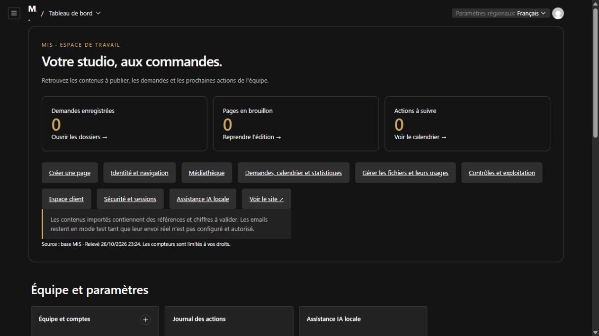
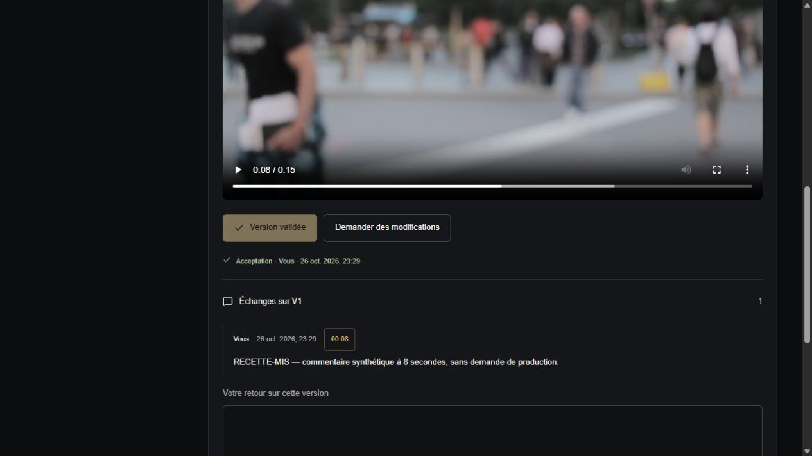
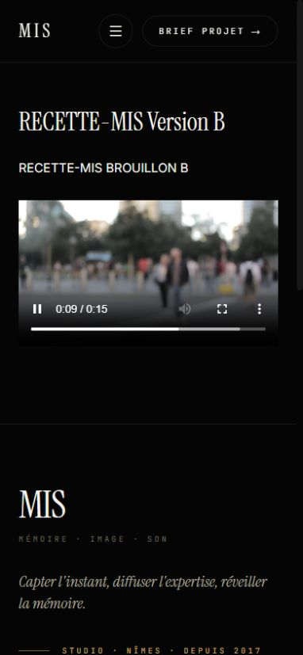

# Exécution sur Coolify — preuves et reprise

Relevé intermédiaire du 26 octobre 2026, jusqu’aux essais de 22:34:42 UTC. Les heures techniques de ce document sont en UTC ; ajouter une heure pour Paris à cette date. Le [tableau des critères](PREPRODUCTION.md) porte l’état du jalon. Aucune conclusion de ce document ne remplit la validation métier de MIS.

Mise à jour du 10 novembre 2026 : la page `/admin/login` de la cible HTTPS répond toujours. L’accès au panneau Coolify a expiré et présente son écran de connexion ; aucun contrôle récent des conteneurs n’est donc disponible. La tentative de déploiement de `b6a030c` a échoué à l’interpolation Compose avant la construction. Le correctif Compose passe parsing YAML, tests CMS (173/173), lint, TypeScript et build Next.js local ; il n’est pas encore déployé. Le jalon doit encore couvrir la recréation, la restauration applicative distincte, la rotation des accès exposés et la remise utilisateur.

## Construction et accès

La ressource `MIS-CMS-PREPRODUCTION`, environnement `mis-preproduction` du projet `Adam`, exécute le Compose dans deux conteneurs :

| Élément | Observation cible |
| --- | --- |
| Révision initiale | `fc2d71580ecec241777c686ef97bb28e15c0073f` |
| Déploiement Coolify | `wfjkzzfarbc8wun31h7ejo7f`, début 22:10:02, terminé 22:11:39 |
| Moteur | Docker 29.5.3, BuildKit/Buildx détectés ; image Node 24.22.1 |
| Web | `web-7uacb4fl5dvn0okdefmxaimf-20261026T221008`, état sain |
| Worker | `worker-7uacb4fl5dvn0okdefmxaimf-20261026T221008`, état sain, passage environ toutes les 63 secondes observé |
| HTTPS | Certificat accepté sans exception ; [rapport de 16 routes](preuves/preproduction-http.json), relevé à 22:12:15 |
| Ressources de l’hôte | 31 Gio de RAM, environ 23 Gio disponibles ; partition de 878 Gio, environ 794 Gio libres lors du relevé |

Les huit pages historiques ont été importées dans une base cible neuve. Les médias locaux des anciennes fixtures n’ont pas été déployés ; les nombres de fichiers diffèrent donc de la base livrable locale. Deux volumes propres à la nouvelle application couvrent `/app/.data` et `/app/.cms`.

La connexion propriétaire et le dashboard sont accessibles :

## Données synthétiques et parcours exécutés

Le script `scripts/cms-target-acceptance.ts` est réservé à une origine HTTPS différente de `mis-prod.fr`, avec environnement `preproduction` et deux circuits email désactivés. Son bootstrap refuse une base ayant déjà des comptes. Les identifiants restent dans `/app/.cms/preproduction-access.json`, en mode `600`, hors du stockage HTTP.

| Objet | Identifiant / contenu |
| --- | --- |
| Page de recette | ID 9, `/recette-mis`, titre `RECETTE-MIS Préproduction` |
| Comptes | Un propriétaire de recette, un client membre et un client exclu ; trois comptes au total |
| Projet / livrable / fichier privé | IDs 1 / 1 / 1, V1, client membre uniquement |
| Média public | ID 1, copie technique de `public/hero.mp4`, 7 040 524 octets, 15,44 s |
| Empreinte du média | `369f229262a6841f24bb87819b506bfe3d5d34bf0a8cb1a307090110d1cfaf03` |
| Sélection privée | ID 1, réservée au client membre, sans média commercial : droits à décider par MIS |

Le parcours de publication a produit les observations suivantes, via le navigateur de préproduction et les processus CMS exécutés sur l’hôte :

1. La version A était publique. Le brouillon B n’a pas remplacé le rendu visiteur après rechargement.
2. La publication de B a changé le rendu visiteur sans redémarrer le serveur.
3. La dépublication a produit la page 404.
4. Le job `schedulePublish` ID 1 a été mis en file avec une échéance ; la boucle worker existante l’a exécuté. Le probe de 22:26:49 rapporte `jobCompleted: true`, et B est redevenue visible. Aucun lancement manuel du job n’a servi à cette preuve.
5. La restauration de la publication ID 9 a rétabli A en brouillon. Le probe de 22:27:08 rapporte A en brouillon, B publique et six versions.

Le client membre a déposé un commentaire à 8 secondes et accepté V1 via les boutons du portail. Le repère `00:08` a déplacé le lecteur privé à 8 secondes. Le client exclu voit zéro projet ; l’URL directe du fichier retourne « Fichier indisponible ». Une sélection privée vide est préparée pour le parcours utilisateur ; aucun droit commercial n’a été déclaré validé.

La vidéo publique a réellement démarré en HTTPS. À 390 pixels de large, l’avance a atteint environ 9,77 secondes sur 15,44 secondes avec `readyState=4`. Le contrôle HTTPS du script opérateur `c6e3898b96ac2828da76db07e8a3382cb61256ef`, exécuté à **22:34:42 UTC**, confirme : fragments public et privé en **206**, exactement **1 024 octets** chacun, fichier privé refusé en **404** au client exclu, fichier MOV volontairement invalide refusé en **400**. Le client membre obtient un projet et une sélection ; le client exclu zéro projet et zéro sélection. Cet essai concerne le MP4 représentatif de 7 Mo ; il ne démontre pas le traitement de masters longs ni une charge simultanée importante.

Un brief `RECETTE-MIS` a été soumis depuis le formulaire public avec une adresse `example.test`. Le navigateur a confirmé « Brief reçu », puis le dossier a été retrouvé et qualifié dans le CRM, avec un propriétaire affecté et une prochaine action. La création du rappel lié échouait sur la conversion de l’identifiant relationnel ; le correctif `b6a030c` et son test local transmettent maintenant l’identifiant canonique, mais cette révision n’a pas encore été déployée ni rejouée dans le CRM cible. Aucun email réel n’a été envoyé.

## Audience

La collecte navigateur est activée sur cette seule préproduction. Le choix de consentement indique sa durée jusqu’au rechargement de l’onglet. Une lecture SQL indépendante en lecture seule a constaté zéro événement avant accord puis après refus. Après accord et lecture de la page synthétique, les agrégats étaient :

| Source | Événement | Clé de contenu | Nombre |
| --- | --- | --- | --- |
| Navigateur consenti | `page_view` | `page-9` | 2 |
| Navigateur consenti | `video_play_manual` | `page-9` | 1 |
| Navigateur consenti | `video_progress` | `page-9` | 2 |
| Serveur | `brief_received` | `form-1` | 1 |

Les coordonnées du brief restent dans le CRM ; elles ne figurent pas dans ces événements d’audience. Après retrait de l’accord, la navigation suivante n’a ajouté aucun événement : le total est resté à six. Les compteurs de cet environnement sont des données de recette, pas l’audience réelle du site actif.

## Persistance et sauvegardes

Les deux conteneurs ont été redémarrés avec `docker restart`, sans retirer leurs volumes. Le probe du 26 octobre à **22:28:21 UTC** confirme : connexion propriétaire réussie, neuf pages, trois utilisateurs, six versions de la page, A en brouillon/B publique, job terminé, accès privé réservé au membre et empreinte du média conservée.

| Sauvegarde cible | Périmètre observé | Vérification |
| --- | --- | --- |
| `2026-10-26T22-21-34.907Z-4170785d` | Huit pages, seize fichiers ; état initial sans comptes | Terminée à 22:21:35 ; copie SQLite, intégrité et SHA-256 des fichiers/configurations vérifiés |
| `2026-10-26T22-28-21.870Z-a096e862` | Neuf pages, dix-huit fichiers ; comptes et vidéo synthétiques, historiques public/brouillon | Terminée à 22:28:22 ; mêmes contrôles réussis |
| `2026-10-26T22-38-49.822Z-acf141ef` | Neuf pages, dix-huit fichiers ; brief, commentaires, acceptation V1 et sélection privée synthétiques | Terminée à 22:38:50 ; vérifications intégrité/empreintes réussies ; aucune tâche CRM encore créée |

Les archives sont dans `/app/.data/backups/<identifiant>`. La commande réalise aussi une copie de vérification dans `/app/.data/restore-checks/<identifiant>`. **Cette copie ne vaut pas encore une restauration applicative dans un autre conteneur.** La recréation de conteneurs avec conservation des volumes et la restauration applicative distincte sont encore ouvertes dans ce relevé.

La sauvegarde de 22:38:50 couvre le brief, le commentaire, l’acceptation V1 et la sélection privée ; elle précède la création du rappel et la rotation des comptes. Une nouvelle sauvegarde devra couvrir l’état final de la recette. L’environnement Coolify injecte ses secrets au runtime ; aucun `.env.local` n’était présent dans le conteneur. Le secret `PAYLOAD_SECRET` et la configuration protégée doivent donc être conservés séparément de cette archive pour une restauration complète, notamment du MFA. La présence d’une copie hors de l’hôte et un objectif de rétention ne sont pas validés.

## Services externes et capacités absentes

| État | Élément | Dépendance précise |
| --- | --- | --- |
| Prêt, configuration/essai réel manquant | Resend | `RESEND_API_KEY`, `CONTACT_SENDER`, domaine expéditeur vérifié ; autorisation d’un essai et de son destinataire, puis confirmation de réception |
| Prêt, accès réel manquant | Search Console | `CMS_SEARCH_CONSOLE`, propriété exacte, compte de service autorisé et clé protégée ; accès, récupération puis affichage à contrôler séparément |
| Validé seulement en local | Ollama et Whisper | Installation et modèles sur l’environnement d’exécution cible ; réseau et ressources à qualifier. La RAM disponible ne prouve pas l’installation ni les performances |
| Décision éditoriale attendue | 37 éléments | [Registre](VALIDATION-EDITORIALE.md) : références, droits, chiffres, témoignages et données légales ; pas de validation déduite du déploiement |
| Non implémenté | HLS, CDN, stockage objet, transcodage | À envisager selon une limite observée ou un besoin validé |
| Non implémenté | Facturation, signature, agenda externe | Aucun service ni intégration ajouté à ce jalon |

Le dashboard cible affiche Resend en mode test, récupération de compte en boîte locale, Search Console désactivée et assistance IA désactivée. Aucun transfert vers une IA externe n’a été réalisé. Les refus d’accès privés et l’absence d’indexation n’attestent pas un audit de sécurité exhaustif.

## Remise des accès

Les trois premiers mots de passe synthétiques ont été affichés accidentellement dans un retour technique de la conversation. Ils ne figurent pas dans Git, ce document ou les captures. **Ils doivent être remplacés et les sessions révoquées avant la remise des comptes.** La procédure opérateur `rotate-access`, dans le script versionné, remplace les trois mots de passe, invalide les sessions et écrit les nouveaux accès uniquement dans le fichier privé. Son exécution et la vérification des anciens accès restent à confirmer dans ce relevé, sans copier les valeurs dans la conversation.

L’accès à cette fiche et aux comptes ne constitue pas une validation métier. Le propriétaire de recette doit être préservé lors du nettoyage ; les comptes clients, objets et liens synthétiques suivent le périmètre explicite de la [fiche administrateur](RECETTE-ADMINISTRATEUR.md).

## Bascule et retour arrière préparés

1. Terminer les critères techniques ouverts, renouveler les accès, faire la recette MIS et arbitrer les éléments éditoriaux nécessaires à leur rediffusion. Fixer la révision exacte, le responsable de bascule, la fenêtre et les critères de retour arrière.
2. Préparer une ressource de production avec ses propres volumes et secrets, l’origine `https://mis-prod.fr` au build/runtime, `CMS_DEPLOYMENT_ENVIRONMENT=production` et les seules intégrations explicitement activées. Importer le contenu validé ; exclure les comptes et objets de recette. Ne pas réutiliser la base de préproduction telle quelle.
3. Conserver l’ancienne ressource et relever sa révision/configuration/domaine. Avant migration d’une base existante, suspendre les écritures et le worker, puis sauvegarder ensemble base, médias, fichiers privés et configuration protégée. Vérifier la restauration et conserver une copie hors du serveur selon la politique approuvée.
4. Après autorisation explicite de la bascule de `mis-prod.fr`, affecter le domaine à la ressource de production prévue. Toute modification DNS éventuelle exige sa propre action autorisée. Vérifier TLS, huit chemins historiques, administration, formulaire, fichiers privés et worker avant de rouvrir les écritures.
5. Si les critères échouent, suspendre les écritures de la nouvelle ressource. Réaffecter le domaine à l’ancienne ressource conservée ; pour un retour sur une installation CMS ayant migré, restaurer un ensemble cohérent code/base/fichiers/secrets dans des volumes distincts, vérifier, puis réouvrir. Un simple retour d’image ne suffit pas après une migration incompatible.

Aucune durée d’indisponibilité de production n’a été mesurée : la construction initiale de recette a pris environ 1 min 37, mais ne mesure pas une bascule ni une restauration. Les seuils, objectifs de sauvegarde et responsables restent à décider avec MIS.
