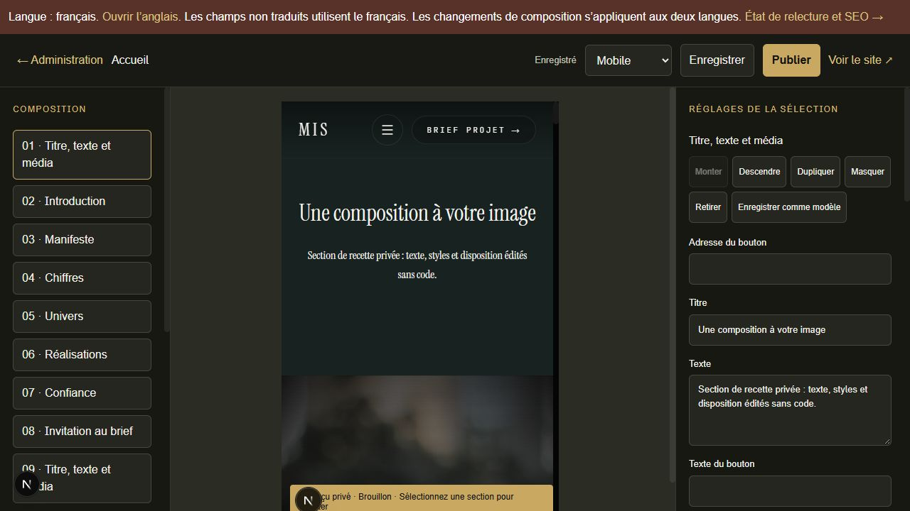

> ARCHIVE HISTORIQUE du compte rendu du 25 octobre. Consulter RECETTE.md pour les résultats actuels. Les mentions d’absence de modèles ont été corrigées après inspection effective du poste.

# Recette du CMS MIS

Recette locale du 25 octobre 2026 sur Windows, Node 26.4.0, Next 16.4.3 et Payload 3.92.0. Branche de travail : `codex/cms-administration`. Aucun déploiement, push Git, email réel ou appel IA payant. Coolify et Resend sont les services confirmés par MIS. L’image et la CI ciblent Node 24.22.1 ; leur exécution sur Linux reste à vérifier.

**Réalisé localement** signifie que le comportement décrit ci-dessous a été implémenté et vérifié dans le périmètre indiqué. **Partiel** désigne un périmètre fonctionnel encore limité. **À connecter** désigne un adaptateur réel livré sans compte ou service opérationnel. **Non vérifié** ne constitue pas une réussite. Les tests métier utilisent de vraies bases SQLite, des migrations et des fichiers réels ; les transports des fournisseurs utilisent des doubles HTTP ou un serveur local de recette, jamais des comptes clients.

## Environnements et données

- Base livrable locale `.data/cms-ready.db` : **8 pages, 9 médias, 9 migrations, 0 compte, 0 brief**, `PRAGMA integrity_check = ok`. Aucun propriétaire prévisible créé. Les bases préexistantes ont été conservées.
- Base navigateur `.data/qa-browser-v2.db` : copie isolée avec un propriétaire à mot de passe aléatoire, un brief synthétique et des modifications de recette. L’ancien essai `.data/qa-browser.db` reste également hors production. Ces bases ne doivent pas être déployées.
- Serveur de développement de recette sur `127.0.0.1:3100`. Compilation de production réellement démarrée sur `127.0.0.1:3200`, d’abord avec QA2, puis contrôle final sur la base livrable sans compte de démonstration. Les pages administratives sont protégées.
- Les huit routes historiques sont conservées. Les chiffres, avis, références et mentions déjà présents dans le dépôt ont été importés, sans les certifier : le diagnostic observé signale **37 éléments à faire valider**, zéro lien/média bloquant dans cette observation. Ne pas confondre ces données éditoriales héritées avec des métriques collectées.
- `CMS_EMAIL_DELIVERY`, `CMS_AUTH_EMAIL_DELIVERY`, `CMS_BROWSER_ANALYTICS` et `CMS_SEARCH_CONSOLE` restent désactivés. Conservation automatique désactivée, durées à zéro.

## Les dix-huit scénarios de réception

| Nº | Exigence | Statut | Preuve et vérification exécutée | Limite ou action restante |
| --- | --- | --- | --- | --- |
| 1 | Administration de la matrice actuelle, microtextes, navigation et footer | Réalisé localement | [Matrice actuelle](MATRICE-ADMINISTRABILITE-ACTUELLE.md), `cms-content-coverage.test.ts`, migration des microtextes et consentement ; formulaire natif des contenus ouvert dans le navigateur, champs interactifs. | La vérification structurelle couvre les sources raccordées ; chaque champ n’a pas été retapé manuellement. Les 37 validations éditoriales appartiennent à MIS. |
| 2 | Nouvelle page et nouvel univers reliés au menu sans code | Réalisé localement | `cms-core.test.ts` crée et publie une page d’univers par la vraie API locale, contrôle son adresse puis sa redirection ; `cms-content-coverage.test.ts` modifie univers et navigation persistés ; route générique livrée. | Renseigner explicitement fiche d’univers, page/bloc et liens. Le parcours complet de création native n’a pas été rejoué intégralement au clic. |
| 3 | Composition, ordre, duplication, modèle et mobile | Réalisé localement | Navigateur : ajout d’une section texte, duplication, déplacement en tête, enregistrement comme modèle indépendant et sauvegarde ; aperçu mobile réellement rendu. [Capture](captures/composition-mobile.png). | Recette conservée uniquement dans QA2. Les listes complexes disposent aussi des champs natifs de Payload. |
| 4 | Styles globaux/locaux, sections synchronisées et copies | Réalisé localement | Navigateur : fond `#182321`, police éditoriale, alignement centré et aperçu mobile. `cms-migration.test.ts` vérifie persistance/isolation/validation des styles ; `cms-publication.test.ts` vérifie les dépendances publiées et restaurées. | Grilles historiques dédiées ; les réglages de colonnes concernent les blocs simples composés. Republier une section synchronisée affecte toutes ses références. |
| 5 | Réalisation, témoignage et tarif réutilisés | Réalisé localement | `cms-content-coverage.test.ts` modifie les trois familles, les conserve en brouillon puis les publie ; composants du site raccordés au même contenu. | Les données importées restent à valider éditorialement, particulièrement références, droits et tarifs. |
| 6 | Brouillons, aperçu, publication, programmation et restauration | Réalisé localement | Navigateur : « Capturer » devient « Composer » seulement après publication ; rechargement public contrôlé. Tests `cms-core`, `cms-publication`, `cms-translations` : versions, conflits, transactions, jobs, corbeille, restauration et locales. [Capture](captures/editeur-publication.png). | Restauration cohérente : composition/globale/sections en brouillon. Titre, adresse et SEO utilisent les versions natives. Caches distribués Coolify non vérifiés. |
| 7 | Import initial rejouable sans perte ni doublon | Réalisé localement | `cms:seed` rejoué : `created:0, existing:8`. `cms:import-media` rejoué : 0 import, 9 existants, 0 échec. Tests de migration réelle sans schema push et conservation des modifications éditoriales. | SVG/ICO historiques exclus de l’import contrôlé ; ils restent à leurs adresses statiques d’origine. |
| 8 | Import, traitement, remplacement, usages et droits médias | Partiel | Tests `cms-media`, `cms-media-import` : vrais fichiers, variantes Sharp, cadrage/focal, octets originaux, reprise, quota, conflits, remplacement des brouillons, versions et restriction. Médiathèque inspectée avec 9 fichiers et consommation mesurée. [Capture](captures/mediatheque-desktop.png). | Pas de stockage vidéo fournisseur ni de chaîne HLS/transcodage de masters. Import reprenable borné à 512 Mio maximum, 100 Mio par défaut. Les anciens fichiers déjà dans `public/` restent publics. |
| 9 | Reprise sans doublon ni résurrection | Réalisé localement | Tests imports interrompus, notifications concurrentes, rappels reprogrammés, jobs après corbeille et transactions après rollback : `cms-media-import`, `cms-operations`, `cms-calendar`, `cms-publication`, `cms-transaction-queue`. | Worker de production à démarrer sur Coolify. Pas de test d’arrêt brutal de la machine ou de panne disque matérielle. |
| 10 | Refus d’accès aux brouillons/fichiers/exports/autres clients | Réalisé localement | `cms-security`, `cms-client`, `cms-mfa`, `cms-brief-files`, `cms-media` : vraies sessions, identifiants d’un autre compte, fichiers HTTP, rôles et API. Serveur de production local : aperçu 404, globale 403, atelier redirigé vers login. | Ce périmètre constitue une recette de sécurité ciblée, pas un audit d’intrusion externe. |
| 11 | Formulaire conditionnel modifié et anciennes réponses lisibles | Réalisé localement | Tests `cms-operations`, `cms-translations`, `cms-brief-files` : validation serveur, conditions, snapshot publié, traduction et pièces autorisées. Navigateur : étapes, erreurs utiles, confirmation après persistance. | Les schémas historiques restent attachés aux réponses ; ne pas effacer leurs pièces manuellement. |
| 12 | Brief conservé malgré panne email, reprise sans doublon | Réalisé localement ; Resend à connecter | Tests transaction brief/outbox, panne/retry, clé d’idempotence et fenêtre fournisseur ; `auth-email.test.ts` contrôle le transport de récupération. Un brief synthétique a été reçu dans le CRM par le navigateur. | Aucun email réel. Après 23 h d’incertitude, réconciliation manuelle chez Resend avant nouvel envoi pour éviter le doublon après expiration de sa garantie. |
| 13 | Attribution, transition, note, rappel, recherche et export CRM | Réalisé localement | Navigateur : brief visible, statut Qualifiée, responsable, note persistée, affichage mobile. Tests `cms-operations`, `cms-calendar` : transitions, recherche, CSV autorisé, rappels/dates Europe/Paris, clôture et notifications. [Fiche](captures/crm-fiche.png), [mobile](captures/crm-mobile.png). | Aucun connecteur de devis/facturation identifié ; documents et états gérés manuellement. |
| 14 | Statistiques réelles, périodes et confidentialité | Réalisé localement ; collecte désactivée | `cms-analytics`, `cms-audience`, `cms-operations` : événements autorisés, consentement, déduplication, champs bornés, agrégats SQL, périodes et réception transactionnelle. État vide et origine des chiffres visibles dans l’interface. | Pas d’historique inventé, pas de visiteurs uniques. Les pages d’entrée concernent le premier événement consenti du chargement. Configuration et relecture de confidentialité avant activation. |
| 15 | Sitemap, redirections, indexation et langues | Réalisé localement | Tests `cms-core`, `cms-translations`, `cms-diagnostics` ; HTTP production local sur huit routes historiques et `/en`, sitemap/robots/404 contrôlés. Traductions non relues ou obsolètes repliées et non indexées selon leur état. | FR/EN livrés ; traduction éditoriale anglaise à produire et relire. Pas de vérification d’indexation chez Google. |
| 16 | Portfolio restreint, projet, timecodes et validation de version | Réalisé localement | `cms-client.test.ts` : projets attribués, portfolio contrôlé, fichiers réels, liens temporaires/révocation, commentaire attaché à la version et validation immuable ; refus croisé entre clients. | Tests API métier ; aucun client réel invité, aucune séance de validation utilisateur externe. |
| 17 | IA et connecteurs configurés, autorisés et bornés | Partiel / à connecter | Adaptateurs serveur Ollama, whisper.cpp, Resend et Search Console. Tests de permissions, quotas, erreurs, sources privées autorisées, JWT Google, reprise et idempotence via doubles/serveur local. Interface d’indisponibilité explicite. | Aucun modèle Ollama/Whisper réel installé, aucun compte Google connecté, aucun email réel envoyé. Facturation, signature, agenda externe et stockage vidéo non identifiés : connecteurs non implémentés. Coolify non déployé. |
| 18 | Commandes, restauration isolée et guide exploitable | Réalisé localement ; production non vérifiée | 143 tests réussis, lint/typecheck/build réussis, contrôle HTTP sur compilation de production, sauvegarde restaurée : intégrité SQLite et SHA-256 de 34 fichiers, 8 pages. Guides d’administration, exploitation, intégrations et point de reprise livrés. | Docker absent : image/Compose/TLS/volumes/CI Linux non exécutés. Sauvegarde hors machine, politique de conservation définitive et responsabilités à définir. |

Les noms courts de tests ci-dessus désignent les fichiers dans [`tests/`](../../tests/). La distinction entre API locale réelle, HTTP, navigateur et doubles de fournisseur est intentionnelle : une réussite locale ne certifie pas une connexion externe.

## Commandes réellement exécutées

| Commande ou contrôle | Résultat observé |
| --- | --- |
| `npm ci` | Installation réalisée après autorisation réseau ; les premières tentatives concurrentes en échec ne sont pas comptées comme validation. |
| `npm run cms:migrate` | Neuf migrations appliquées aux bases livrable et QA2 ; schema push désactivé. |
| `npm run cms:seed` | Réexécution finale : 0 nouvelle page, 8 existantes. |
| `npm run cms:import-media` | Réexécution finale : 9 existants, 0 nouveau, 0 échec ; exclusions SVG/ICO documentées. |
| `npm run lint` | Réussi. |
| `npm run typecheck` | Réussi. |
| `npm run test:cms` | **143 réussis, 0 échec, 0 ignoré**, environ 49,1 s. Rapport local `.data/recette-tests.log`. Les données des tests restent dans `.data/tests`. |
| `npm run build` | Réussi ; routes publiques, CMS, atelier, CRM, clients, fichiers, transcription et Search Console présentes. |
| `npm run start -- --hostname 127.0.0.1 --port 3200` | Compilation de production démarrée sur QA2, puis validation finale sur la base livrable. |
| `CMS_CHECK_URL=http://127.0.0.1:3200 node scripts/cms-http-check.mjs` | Neuf pages 200 avec données structurées, aperçu/globale protégés, atelier protégé, 404, sitemap et robots conformes aux assertions. Sous PowerShell, définir la variable avec `$env:CMS_CHECK_URL=...` avant la commande. |
| `npm run cms:backup` | `completed`, 25/10/2026 à **20:41:47 Europe/Paris** (`19:41:47Z`), identifiant `2026-10-25T19-41-47.434Z-d2b7adc2`, 34 fichiers et 8 pages ; restauration isolée et empreintes vérifiées. |
| `npm run cms:retention` | Aperçu seulement : `applied:false`, politique désactivée, 0 ligne/0 archive concernée. |
| `git diff --check` | Aucune erreur d’espacement ; avertissements de conversion LF/CRLF Windows seulement. |
| YAML Compose / worker / snapshot | Parsing YAML/ancres réussi, syntaxe worker contrôlée ; snapshot final comparé aux 288 tables et prochaine différence de schéma vide. Docker non disponible. |

L’avertissement Node `DEP0205` sur `module.register()` reste émis par l’outillage ; il n’a pas fait échouer les contrôles. Les reprises de développement après migrations ont été vérifiées après rechargement ; les anciennes erreurs de schema encore présentes dans l’historique de console ne sont pas comptées comme résultat de la version finale.

## Parcours visuels et corrections

Le navigateur de recette a été utilisé réellement, sans simulation de captures. Contrôles bureau et viewport mobile 390 × 844 : accueil/menu, atelier, médiathèque, formulaire et CRM. Clavier Tab et focus visible contrôlés sur le formulaire. Ajout et réordonnancement d’une composition, largeur mobile, fond personnalisé, police et alignement constatés dans le rendu partagé. L’éditeur natif de la globale charge les valeurs et rend les champs modifiables après hydratation.

Corrections issues de cette recette : bouton « Continuer » empêchant la soumission prématurée de l’étape suivante ; libellés et placeholders plus lisibles ; focus visible ; langue des sous-titres liée au média ; transcription éditoriale affichable. Un unique titre principal est désormais conservé après déplacement, masquage et répétition de sections, y compris synchronisées : quatre tests SSR dans `cms-headings.test.tsx`, puis confirmation dans le navigateur (nouvelle section H1, introduction suivante H2). Le message de configuration IA n’est plus répété dans l’en-tête. Ces vérifications ne constituent pas une certification d’accessibilité ni une campagne exhaustive sur tous les navigateurs.

Les captures contiennent uniquement des données historiques déjà dans le dépôt et des données synthétiques de recette. Elles sont des preuves d’interface, pas des captures de production.

## Limites avant mise en production

1. Relire les contenus hérités et renseigner l’identité légale, les justificatifs, les vrais liens sociaux et les autorisations de diffusion. Coolify est un logiciel d’hébergement, pas l’identité juridique de l’hébergeur à inventer dans les mentions.
2. Construire l’image sur l’hôte Coolify, vérifier Node 24.22.1, les volumes persistants, leurs droits, le domaine/TLS, puis exécuter la recette avec la configuration réelle. Une seule instance web et un worker sur disque local pour cette version SQLite. Arrêter l’ancien worker et les écritures avant migration.
3. Créer le propriétaire avec `cms:owner` depuis des variables protégées. Ne pas importer les comptes/bases de recette. Prévoir TOTP, récupération et accès de secours.
4. Fournir Resend dans les secrets de l’hébergement : clé, domaine expéditeur vérifié et expéditeur ; relire destinataires et modèles. Activer séparément réception commerciale et récupération de compte, puis autoriser un essai vers une adresse contrôlée. Ne pas coller de secret dans le chat.
5. Brancher seulement les services retenus : propriété et compte autorisé Search Console ; modèles/services locaux pour IA/transcription ; choisir les autres fournisseurs si nécessaires. Une absence de configuration doit rester visible.
6. Définir la politique de collecte/conservation et la sauvegarde hors machine chiffrée. Les archives de conservation, anciennes versions, fichiers clients et sauvegardes n’ont pas de purge finale automatique. Vérifier une restauration applicative sur le serveur cible avant ouverture.

Procédures : [guide d’administration](GUIDE-ADMIN.md), [exploitation et retour arrière](EXPLOITATION.md), [intégrations](INTEGRATIONS.md), [architecture](ARCHITECTURE.md), [cadrage](CADRAGE.md), [point de reprise](AVANCEMENT.md). La mission est vérifiée localement dans ce périmètre ; elle n’est pas déclarée déployée ni entièrement connectée.
