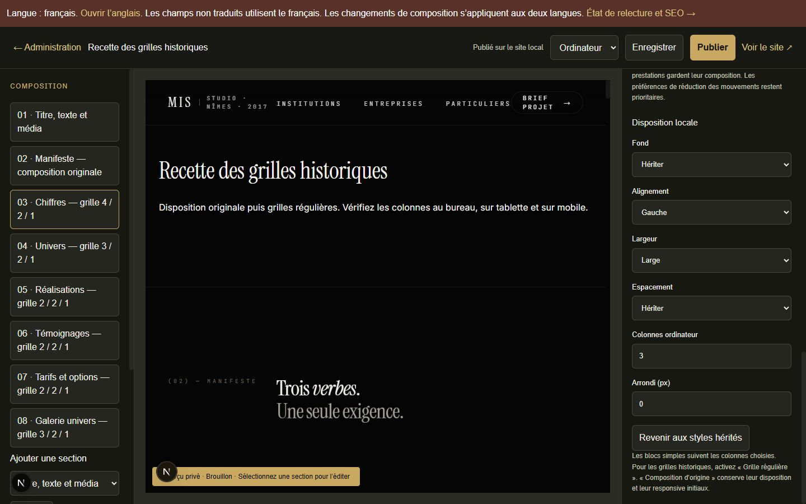
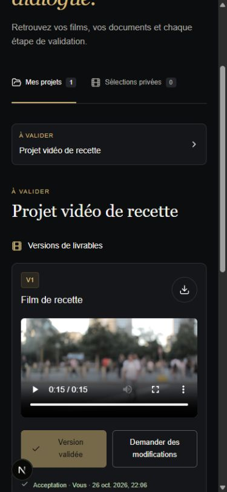

# Recette ciblée du CMS MIS — 26 octobre 2026

Le socle existant est conservé : branche `codex/cms-administration`, Payload 3.92.0, Next 16.4.3, Windows et Node 26.4.0. Coolify et Resend sont les services confirmés. Aucun déploiement, push, email réel, modification DNS, achat ou transfert privé vers une IA externe. Le [bilan du 25 octobre](RECETTE-20261025.md) est archivé comme preuve historique ; les résultats ci-dessous décrivent la finalisation actuelle.

## État des données

La base livrable `.data/cms-ready.db` contient **8 pages, 9 médias, 10 migrations, zéro compte et zéro brief**, intégrité SQLite `ok`, relevé final daté dans la preuve. [Preuve](preuves/base-livrable.json). La dixième migration ajoute 83 colonnes de disposition aux blocs et à leurs versions ; le snapshot contient 288 tables. Une copie préalable à cette migration a été conservée.

Les essais sont isolés sous `.data/tests/`. Le navigateur a utilisé la fixture `video-browser-N5e4Da`, avec dix migrations, deux comptes aléatoires, une page vidéo et une page de grilles supplémentaires. Son consentement d’audience est activé uniquement pour la recette. Ne pas déployer ces bases ni leurs identifiants. Les anciennes bases QA restent conservées.

Les flags de la base livrable restent désactivés : emails commerciaux, emails d’authentification, audience navigateur, Search Console et conservation automatique. Aucun justificatif éditorial n’a été inventé.

## Matrice de finalisation

« Vérifié localement » désigne le périmètre effectivement exécuté. Un contrat HTTP intercepté valide l’adaptateur, pas le compte fournisseur ni la livraison réelle.

| Fonction | État du code | Environnement réellement vérifié | Preuve | Dépendance restante |
| --- | --- | --- | --- | --- |
| Huit pages, menus, footer, coordonnées, formulaires, microtextes et SEO | Structurés dans le CMS, versions publique/brouillon séparées | SQLite migrée, SSR et navigateur | [Matrice détaillée](MATRICE-ADMINISTRABILITE-ACTUELLE.md), tests couverture/publication/traductions | Relecture des textes et traductions ; tous les champs n’ont pas été retapés au clic |
| Grilles historiques | Mode d’origine conservé ; mode régulier avec colonnes bureau/tablette/mobile, styles et visibilité | Navigateur 1440, 820 et 390 px, sans débordement horizontal | [Mesures](preuves/grilles-navigateur.json), [publication](preuves/grille-publication.json), tests grilles/migration | En-têtes, bandeaux et lignes de prestations conservent leur composition explicitement décrite |
| Logo, favicon, SVG/ICO | Sélecteur de média dans la globale et atelier ; SVG statiques et ICO décodables contrôlés, source immuable | Imports physiques, refus de formats actifs, sélection native du favicon | Tests icônes/vidéo ; [capture](captures/identite-selecteur-media.png) | Icônes techniques restent dans le code ; droits d’identité à fournir |
| Brouillon, aperçu, publication, restauration | Composition et dépendances cohérentes ; contrôle de conflits | Navigateur : chiffres 4 → 3 colonnes enregistrés en brouillon, public encore à 4, puis à 3 après publication | [Preuve](preuves/grille-publication.json), tests versions/publication | Proxy et caches Coolify non vérifiés |
| Vidéo publique locale | Import fragmenté, empreinte, poster, VTT, transcription éditoriale, Range, quota et remplacement | Vrai MP4 H.264 1920×1080 de 15,44 s, fichiers persistants relus par autre processus ; lecture et avance navigateur | [Chaîne vidéo](CHAINE-VIDEO.md), [preuve navigateur](preuves/video-navigateur.json), tests vidéo/média/import | HLS, CDN, transcodage de masters et stockage objet non implémentés ; pas requis pour le périmètre local borné |
| Vidéo privée et versions client | Session/projet, expiration/révocation, plages d’octets, versions immuables | Client attribué : lecture, commentaire à 00:13 et acceptation V1 ; mobile 390 px. Refus croisés et liens temporaires par HTTP testé | [Capture](captures/client-video-validation.png), tests client/vidéo | Les octets déjà téléchargés et copies/cache hors MIS ne peuvent pas être rappelés |
| Worker et programmations | Bail unique, signal daté, lots bornés ; jobs incertains mis en erreur sans rejeu | Vrais processus Windows arrêtés puis redémarrés ; reprise de notification avec transport de test dédupliqué | [Preuves exploitation](PREUVES-EXPLOITATION.md), tests worker/calendrier | Gestionnaire de services et observation sur l’hôte Coolify à réaliser |
| Propriétaire initial | CLI explicite, secret non logué, concurrence protégée | Migrations réelles, création puis connexion ; deux CLI concurrentes aboutissent à un seul propriétaire | `cms-owner.test.ts` | Création du propriétaire réel dans les secrets/terminal de l’environnement cible |
| Resend | Outbox durable commerciale, trois reprises automatiques maximum, clé stable et fenêtre 23 h ; auth séparée | Vraie SQLite, panne/reprise/kill et contrat HTTP intercepté ; aucun email réel | [Preuves intégrations](PREUVES-INTEGRATIONS.md) | Clé/domaine/adresses et essai contrôlé ; `sent` signifie accepté par API, aucun webhook de livraison ; auth sans outbox |
| Search Console | Lecture seule, état daté, permissions, reprise et cache de période | SQLite et transport Google injecté, JWT RSA éphémère ; aucun compte Google | [Preuves intégrations](PREUVES-INTEGRATIONS.md) | Propriété et compte de service autorisé ; synchronisation manuelle, pas de rafraîchissement automatique d’une période terminée |
| Audience | Activation serveur + consentement ; agrégats séparés du CRM | Navigateur : 0 événement avant/refus, 11 après accord et parcours, toujours 11 après retrait/navigation | [Preuve](preuves/consentement-navigateur.json), tests analytics/audience | Choix de conservation et activation réelle. Jalons vidéo = positions atteintes, pas durée regardée ; aucun taux visiteurs → briefs |
| Ollama | Boucle locale, quotas et suggestion privée | Ollama 0.40.6, modèle déjà installé, génération réelle française synthétique, cloud désactivé | [Recette réelle](IA-LOCALE-RECETTE.md), [JSON](preuves/ia-locale.json) | Qualité métier, ressources et service permanent sur l’hôte cible |
| Whisper | Adaptateur local, sources autorisées, quotas, suggestion privée | whisper.cpp b5454 / tiny, transcription réelle d’un extrait public anglais ; persistance par autre processus | [Transcription locale](TRANSCRIPTION-LOCALE.md), [JSON](preuves/transcription-locale.json) | Français, conversion FFmpeg, charge et service permanent à qualifier séparément |
| Sauvegarde et restauration | Base, fichiers/configuration, empreintes, racines contrôlées ; procédure de bascule | Base livrable : 34 fichiers/8 pages restaurés. Fixture représentative : 18 fichiers, ouverture par nouveau processus, connexion/drafts/versions et accès privés | [Preuves exploitation](PREUVES-EXPLOITATION.md), test restauration applicative | Arrêt des écritures pour cohérence inter-fichiers, copie chiffrée hors machine et restauration sur cible |
| Docker/Coolify | Dockerfile, volumes, migrations, web/worker et contrôles préparés | Inspection Windows et WSL ; aucun moteur ni socket disponible | [Exploitation](EXPLOITATION.md) | Image, Compose, recréation des conteneurs, droits volumes, HTTPS/proxy et déploiement **non exécutés** |
| Contenus hérités | Diagnostic et registre exploitables | Export en lecture seule du contenu réellement publié : 37 signalements | [Validation éditoriale](VALIDATION-EDITORIALE.md) | Décisions MIS sur références, témoignages, chiffres, prix, droits, identité légale et traductions |

## Commandes et résultats

| Contrôle | Résultat actuel |
| --- | --- |
| `npm run cms:migrate` | Dixième migration appliquée à la base livrable ; huit pages et neuf médias conservés |
| `npm run lint` / `npm run typecheck` | Réussis sur la version finale |
| `npm run test:cms` | **172/172 réussis**, zéro échec/ignoré, 91,4 s ; comprend la restauration applicative et la reprise du worker sans journal. Le passage intermédiaire à 170 est remplacé par ce résultat final |
| `npm run build` | Réussi : compilation webpack, types, génération et traces. Les deux erreurs de types de scripts de recette du premier essai ont été corrigées avant cette relance |
| `npm run start -- --hostname 127.0.0.1 --port 3200` puis `node scripts/cms-http-check.mjs` avec `CMS_CHECK_URL=http://127.0.0.1:3200` | Vraie compilation de production démarrée localement : neuf routes publiques 200, aperçu 404, globale 403, atelier redirigé au login, 404/sitemap/robots conformes |
| `git diff --check` | Aucune erreur d’espacement ; avertissements LF/CRLF Windows seulement |
| `npm run cms:backup` | `completed`, 26/10/2026 21:15:57 UTC, identifiant `2026-10-26T21-15-56.872Z-2b0224e7`, 34 fichiers et 8 pages |
| `npx tsx scripts/cms-ai-local-check.ts` avec variables locales | Réussite réelle Ollama : 1 demande, 1 réservation, répétition sans nouvelle inférence |
| `npx tsx scripts/cms-whisper-local-check.ts` | Réussite réelle Whisper à 21:12:17 UTC : 1 demande, 1 réservation, source inchangée, durée du contrôle 2 395 ms |
| `npx tsx --env-file-if-exists=.env.local scripts/cms-editorial-review.ts` | 37 signalements exportés ; fichiers existants préservés par défaut, aucune modification du contenu |

Les journaux locaux sont `.data/finalisation-{lint,types,tests,build,http,backup}.log`. Le [relevé de validation](preuves/validation-finale.json) conserve les commandes et empreintes des journaux. Les avertissements `DEP0205` viennent de l’outillage Node ; ils ne valent pas échec. Les contrôles ciblés sont décrits par ce qu’ils vérifient, pas seulement par leurs noms. La CI Linux distante n’a pas été exécutée.

## Parcours navigateur réellement exécutés

Grilles régulières : calcul CSS observé à trois tailles, présentation d’origine maintenue, sauvegarde en brouillon puis publication au clic dans la seule fixture. Favicon : sélection d’une image publique autorisée dans le champ natif, autosave constaté, icône publique restée `/favicon.svg` après rechargement. Aucun compte réel ni contenu livrable modifié.

Vidéo publique : affiche visible, lecture volontaire, durée/dimensions décodées, avance et piste anglaise chargée. Vidéo privée : connexion du client de recette, lecture, commentaire lié à V1 et au repère du lecteur, acceptation affichée puis déconnexion. Les tests HTTP couvrent également les Range, erreurs, restrictions, échéances et révocations. Les contrôles de navigateur ne simulent pas une charge concurrente ni tous les codecs.

Audience : refus avant lecture = base vide ; accord puis lecture et formulaire jusqu’aux coordonnées = deux pages vues, une entrée, un clic contact, un début de formulaire, deux étapes, une lecture manuelle et quatre jalons. Retrait puis navigation/rechargement = aucun événement supplémentaire. Le brief synthétique saisi n’a pas été envoyé. Les données commerciales et les observations consenties restent séparées.

## Mise en production à préparer, sans l’exécuter

Les instructions complètes, ordre migrations/worker, secrets, volumes, restauration et retour arrière figurent dans [EXPLOITATION.md](EXPLOITATION.md). Le code local comporte des modifications non commitées : choisir une révision/tag immuable après revue avant de construire l’image cible. Ne pas utiliser les bases de recette.

Arrêter l’ancien worker et les écritures du web avant sauvegarde/migration ; tester la restauration sur un ensemble isolé ; prévoir une fenêtre d’indisponibilité et un retour arrière associant le même code, la même base, les médias et les secrets. La durée de cette fenêtre doit être mesurée sur l’hôte cible. Un rollback peut perdre les écritures intervenues après la sauvegarde : les recenser et les réconcilier.

Fournir les secrets directement dans Coolify, jamais dans le chat. Valider le domaine et l’expéditeur Resend avant un essai réel explicitement autorisé ; configurer Search Console seulement pour une propriété autorisée. Maintenir les états non configurés visibles. Les connecteurs de facturation, signature, agenda externe, CDN/HLS et stockage objet restent non implémentés : ils nécessitent d’abord un besoin et un service identifiés.

La revue automatique avait refusé l’adaptateur IA externe à cause du risque de transfert de contenus privés. Ce refus est respecté : aucun adaptateur externe ajouté, aucun transfert privé effectué. Les générations et fichiers de recette sont synthétiques ou publics.
